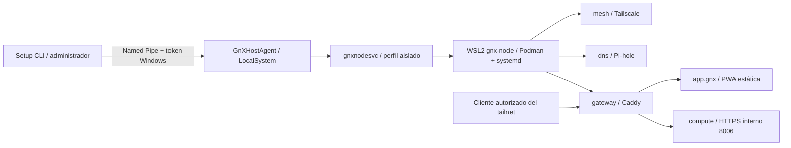

# GnX Node — arquitectura vigente

## Paradigma de evolución aprobado

Los nuevos requisitos se implementan mediante configuración externa y un único
lifecycle. No hotfixes en guests ni scripts temporales de trabajo del agente.
La entrega exige build, instalación, verificación tras restart, evidencia browser
y publicación de artefactos/inputs offline verificada también en el S3 aprobado.
Autoridad de agentes: [40-config-driven-deployments](../.AGENTS/40-config-driven-deployments.md).

El motor genérico de perfiles, la clave Tailscale reusable en secret store y la
carga de bundles Quadlet desde el frontend son **objetivos aprobados**, no funciones
ya disponibles. [Diseño, límites y baseline](config-driven-platform.md). Las secciones
siguientes describen el contrato instalado/histórico; no autorizan saltarse su IPC,
privilegios ni autenticación para adelantar esos objetivos.

## Decisión

GnX Node instala un servicio Windows Rust, una identidad dedicada `gnxnodesvc`
y su distro WSL2 `gnx-node`. Podman/systemd ejecutan cuatro capacidades:

| Capacidad | Implementación | Contrato |
| --- | --- | --- |
| `mesh` | Tailscale | Red privada, `/dev/net/tun` |
| `dns` | Pi-hole | Split DNS privado `gnx` |
| `gateway` | Caddy | HTTPS privado para `app.gnx`, `compute.gnx`, `rustfs.gnx`, `pocket.gnx` y `netbird.gnx` |
| `compute` | Imagen sellada Proxmox | KVM y HTTPS interno `8006` |

Desde v0.1.2, **Setup es una CLI Rust mínima**. v0.1.4 la publica como `gnx` en el PATH del host, permite rotar de forma segura la contraseña de Proxmox y conserva el flujo de actualización. No hay WebView2, assets locales
de Setup ni puente de credenciales en el navegador. `https://app.gnx` conserva
exclusivamente la vista cotidiana de estado y acceso a compute.

La sustitución afecta la presentación del alta, no el servicio, protocolo,
identidad dedicada, distro, imágenes ni límites de confianza.

## Instalación y uso

1. Burn eleva e instala el MSI. El MSI copia archivos y registra/inicia
   `GnXHostAgent`; no ejecuta provisioning Linux dentro de su transacción.
2. Al terminar, el usuario pulsa **Launch** para abrir `gnx --pause` elevado.
   Burn usa `ApprovedExeForElevation` y la ruta escrita por el MSI en HKLM.
   Las instalaciones silenciosas no abren prompts. Con MSI directo se ejecuta
   la consola instalada manualmente como administrador.
3. En un nodo nuevo, la CLI solicita contraseña Proxmox y confirmación con eco
   desactivado; envía `Provision`. Si alcanza `MESH_PENDING`, continúa en la misma
   ejecución solicitando la clave Tailscale `tskey-auth-*` y envía `JoinMesh`.
4. Un nodo `NODE_READY` no vuelve a pedir credenciales. Un nodo ya inscrito con
   fallo de verificación conserva sus credenciales; se reconcilia con `Retry`,
   no se interpreta el fallo como permiso para volver a inscribirlo.
5. El host Windows local recibe automáticamente la confianza de la CA pública
   del nodo y acceso HTTPS loopback a `app.gnx`/`compute.gnx` antes de declarar
   `NODE_READY`. El administrador completa Split DNS y confianza de la CA pública
   solo en clientes tailnet externos cuando sean necesarios. La interfaz cotidiana
   queda en `https://app.gnx`; Proxmox en `https://compute.gnx`.

```powershell
# En PowerShell elevado, después de instalar:
& "${env:ProgramFiles(x86)}\GnX Node\gnx.exe"
& "${env:ProgramFiles(x86)}\GnX Node\gnx.exe" status
& "${env:ProgramFiles(x86)}\GnX Node\gnx.exe" set password
& "${env:ProgramFiles(x86)}\GnX Node\gnx.exe" retry
```

El MSI agrega el directorio instalado al PATH de sistema. Una terminal nueva del usuario host puede invocar `gnx`; la identidad dedicada sigue sin login interactivo y no ejecuta la CLI.

Comandos: alta guiada sin argumentos o con `setup`; `status`, `set password`,
`join`, `retry`, `cancel`, `help`, `version`. `password` y `provision` se
mantienen como alias de `set password`. Esta operación permite definir o rotar
la contraseña de `root@pam` sin reemplazar la identidad mesh existente; el valor
se solicita dos veces con eco desactivado y nunca se acepta en argv. `--pause` mantiene visible el resultado en una
consola interactiva. No se aceptan credenciales por argumentos, variables de
entorno ni entrada redirigida. Un error del servicio produce salida no cero.

`status` es lectura. `retry` no lleva secretos: reconcilia el payload y las
reglas de ingreso y vuelve a verificar; **puede reiniciar compute/gateway**.
`cancel` registra un checkpoint seguro, no destruye recursos ni garantiza
interrumpir instantáneamente una llamada síncrona en curso.

## Límites de confianza



- Único control privilegiado: `\\.\pipe\GnX.Platform.Control`, DACL explícita
  `SYSTEM`/`Administrators`, clientes remotos rechazados y token elevado validado.
- Operaciones versionadas: `GetProgress`, `Provision`, `JoinMesh`, `Retry`,
  `Cancel`. No shell arbitrario, API HTTP localhost ni operación `Deprovision`.
- La CLI verifica el proceso servidor contra `gnx-host-agent.exe` instalado
  junto a ella. El agente limita frames, valida versión, replay y transición.
- La PWA no abre pipes ni recoge credenciales del nodo. GitHub tiene una sola
  operación directa contra `api.github.com`: token clásico en memoria, comprobación
  de scopes `repo`/`workflow`, creación de repositorio privado e instalación del YAML
  elegido con consentimiento explícito. No usa protocolo nativo/UAC para GitHub,
  no importa `gh`, no inicia OAuth y no almacena sesiones. El YAML se proporciona
  como configuración; no se incrusta en JavaScript. Los secrets y la ejecución de
  Actions se administran en GitHub. La integración nativa previa permanece en la
  CLI por compatibilidad, pero no participa en este flujo de la PWA. Su Service Worker cachea solo assets, nunca `status.json`
  ni respuestas de compute.
- No se adoptan cuentas o distros ajenas. Se conserva el aislamiento del perfil
  y la credencial Windows protegida con DPAPI para el transporte existente.

## Secretos y estado

La contraseña Proxmox **la define la persona administradora** durante el alta;
no se descubre ni se genera una contraseña predeterminada desde la PWA.
La clave Tailscale también la proporciona esa persona.

Setup desactiva el eco antes de leer, restaura el modo de consola y borra los
buffers en memoria. Crea un bundle efímero en el directorio temporal del usuario,
aplica una DACL protegida antes de escribir valores y envía **solo la ruta**
por el pipe. El servicio consume/elimina el bundle y crea los archivos separados
`TS_AUTHKEY` y `PROXMOX_PASSWORD` para el contrato Linux. El cliente limpia el
bundle si la entrega falla; el servicio limpia su staging conocido al arrancar.

La clave de alta Tailscale se consume y elimina; una interrupción anterior a su
consumo puede requerir otra clave. La contraseña Proxmox sí se conserva en
`/var/lib/gnx-node/secrets/compute.env`, protegida con modo `0600`, para reinicios.
No se incluyen valores en Git, argv, URLs, logs, progreso ni estado público.
La CA privada queda protegida en `%ProgramData%\GnX\Node\state\ca`; solo se
presenta al usuario la ruta del certificado público.

La única fuente de estado Windows es `%ProgramData%\GnX\Node\state\`:
snapshot y journal sanitizados. El protocolo incluye estado/fase, secuencia,
identificador de operación, porcentaje, error, reinicio y acciones públicas.
Estados definidos: `NEW`, `WINDOWS_READY`, `REBOOT_REQUIRED`, `WSL_READY`,
`RUNTIME_READY`, `MESH_PENDING`, `NODE_READY`, `BLOCKED`, `FAILED`,
`RECOVERY_REQUIRED`. No se promete reanudación automática de pasos que necesiten
secretos después de reiniciar; se vuelve a ejecutar Setup para consultar y continuar.

`NODE_READY` exige verificación del runtime y publicación local de acceso en el
host Windows: confianza de CA y loopback HTTPS (incluido `rustfs.gnx`) se reconcilian con un código de
error estable antes de afirmar ready. Split DNS y confianza de CA siguen siendo
acciones humanas separadas solo para clientes tailnet externos. Un fallo no se
convierte en estado verde ni autoriza borrar identidad, distro, datos o credenciales.

## Runtime y contratos externos

Rust orquesta archivos; no contiene scripts, Quadlets, firewall ni templates
Linux incrustados. Se conserva la arquitectura de archivos externos:

| Fuente | Uso |
| --- | --- |
| `payload/host/.wslconfig` | Perfil dedicado; virtualización anidada |
| `payload/host/gnx-node-rootfs.tar` y `.sha256` | Rootfs sellado; verificar antes de importar |
| `payload/node/install.run` | `check` / `install` idempotentes, secretos por ruta |
| `payload/node/verify.run` | Verificador canónico, JSONL sanitizado y exit code |
| `payload/node/services/` | Quadlets por capacidad e imágenes por digest |
| `payload/node/network/ingress.nft` | Ingreso limitado a loopback y tailnet |
| `payload/node/gateway/routes.conf` | TLS y proxy a OAuth2 Proxy para toda la PWA; excepciones públicas signed-out/worker de retiro; HTTPS a compute y servicios privados |
| `apps/web-app/` | Assets estáticos ensamblados dentro del payload Linux |

RustFS conserva su sidecar Tailscale y TLS nativo con la CA privada del nodo.
`rustfs.gnx` resuelve al gateway existente; `rustfs.mesh.gnx` resuelve sólo al
sidecar para el backend de Caddy. Caddy consulta Pi-hole en loopback:5353 y valida
CA y nombre `rustfs.gnx` del backend. La política del tailnet debe permitir al
nodo gateway conectar a los servicios RustFS en TCP 443; no se abre el underlay.
La salud del workload exige también HTTPS del dashboard a través de Caddy.

Pocket ID, NetBird combined server, dashboard y RustFS comparten el **LXC de
servicios privados**, su identidad mesh y bundle offline. El árbol fuente es
`payload/node/workloads/private-services/`. RustFS denomina sólo almacenamiento.
El tag `gnx-rustfs`, la clave IPC `rustfs`, hostname y rutas guest/runtime
anteriores se conservan como compatibilidad de ownership; no se recrean ni
se renombran los datos/identidad del guest existente. No sustituyen
el transporte Tailscale del nodo. Caddy conserva los nombres públicos privados
`pocket.gnx`/`netbird.gnx`; los nombres `*.mesh.gnx` son exclusivamente backend.
Las imágenes nuevas están fijadas al digest **importado del archive offline**,
no al digest incidental de un almacén de desarrollo con manifests previos.

La política del tailnet debe permitir **del nodo gateway al LXC administrado**
TCP `1411` (Pocket ID), `8080` (dashboard), `8081` (backend) y UDP `3478` (STUN),
además del TCP `443` existente. El retorno **LXC → nodo gateway** necesita DNS
TCP/UDP `53` y HTTPS TCP `443` para discovery OIDC y salud del relay.
Sólo los clientes autorizados necesitan UDP
`3478` hacia el nodo gateway para STUN. No se abren esos puertos en LAN/underlay
ni se modifica automáticamente la política externa del tailnet. El preflight
`compute/access-mesh-policy.run` consulta las reglas resueltas del sidecar y
emite `ACCESS_MESH_POLICY_REQUIRED` cuando faltan permisos. La actualización
comprueba esa condición antes de detener/reinstalar el workload existente.
`NODE_READY` también exige discovery HTTPS, dashboard, gRPC y relay/STUN reales;
una página de login o health local no acredita autenticación.

La asociación OIDC usa un cliente confidencial de Pocket ID y el issuer integrado
`https://netbird.gnx/oauth2`. El primer bootstrap guarda una identidad local de
recuperación y un PAT de un día en archivos root `0600`; nunca adopta o resetea una
cuenta existente sin ownership conocido. El passkey personal requiere la persona
operadora. Los diagnósticos imprimen salud, conectividad y categorías de errores,
no variables de entorno, claves, cookies ni respuestas de autenticación.

Tailscale requiere TUN, **no KVM**. Compute requiere `/dev/kvm` funcional y
virtualización habilitada en firmware/Windows; no se simula disponibilidad.
El gateway valida la CA de backend de Proxmox; nunca usa TLS inseguro.
El puerto interno `8006` no se publica directamente a LAN/tailnet. No se abre
DNS público ni puertos del router. Un apagado global de WSL/reinicio del host
requiere consentimiento; no se usa para validar una actualización por sorpresa.

## Autenticación de app.gnx — decisión aprobada

**OAuth2 Proxy + Pocket ID**, con Valkey para sesiones de servidor. Alcance para
agentes: [contrato PWA auth](../.AGENTS/30-pwa-auth.md). No hay migración de red a
NetBird ni cambio del Named Pipe/control privilegiado.

Caddy termina TLS → OAuth2 Proxy valida OIDC/grupo y sirve los archivos estáticos.
Toda la PWA, assets y `status.json` requieren sesión de un miembro de
`gnx-app-users`. Cliente confidencial exclusivo de GnX App, PKCE S256/nonce,
CA privada y secretos persistentes por archivo, nunca en argv/env/browser JS.
No se asignan personas al grupo automáticamente. Pocket ID conserva su alta y
passkey reales. Si falta Pocket/guest activo, se bloquea el acceso; recuperación
por CLI, no un bypass anónimo ni despertar de guests detenidos.

Logout local elimina la sesión Valkey y cookie mediante POST del mismo origen;
retorno fijo a `/signed-out`, sin tokens en URLs ni cierre global del IdP.
Cookie con TTL de 15 minutos, renovable; refresco solicitado cada minuto:
no prometer revocación
inmediata por grupo hasta medir el comportamiento del IdP fijado. Valkey no
persiste sesiones: un reinicio invalida las anteriores.

No se guarda un shell offline autenticado. `sw.js` sólo retira cachés/worker viejo
(público para actualizarlo aun sin sesión); `/signed-out` es texto público. Son
excepciones sanitarias, no acceso a la aplicación. Cache-Control no-store en
respuestas, limpieza de storage/cache al logout y DOM oculto en salida/BFCache.
Pruebas de disponibilidad no sustituyen aceptación de sesión real, grupo y
replay post-logout. Documentar honestamente cualquier interacción personal pendiente.

## Imagen OCI de compute

La imagen pertenece a `https://github.com/mayas-alas/tailnet-proxmox`, no al
workspace del producto. Ese repo actualiza `dockur/proxmox` y retira dos mecanismos:
la instalación de `pve-fake-subscription` y `blockLicense()`/su llamada, que
redirigía `shop.maurer-it.com` a loopback en el contenedor independientemente del
paquete. No añade activación falsa ni nag bypass. Repos apt no-subscription,
adaptaciones necesarias de contenedor y NAT upstream no son licencias falsas.
Su CI verifica el parche acotado, ausencia del paquete/caché falsa/bloqueo hosts,
boot de Proxmox y KVM antes de publicar el OCI exacto con Skopeo en
`ghcr.io/mayas-alas/tailnet-proxmox`, preservando y verificando el manifest digest.

Quetzalcoatl solo consume `Image=ghcr.io/mayas-alas/tailnet-proxmox@sha256:…` en
`payload/node/services/compute.container`. Podman/Quadlet gestiona la descarga y
el almacén de la identidad dedicada; no se incorpora un Containerfile, builder,
importer HTTP ni credenciales del usuario host. Las reglas de red, CA, secretos,
volúmenes, KVM y LXC del producto siguen siendo payload externo. Un digest nuevo
puede recrear el contenedor compute: la aceptación con VMs/LXC existentes exige
un upgrade explícito y no se deduce del smoke test aislado de la imagen.

MSI sólo instala el payload Windows. El snapshot read-only compara su marker con
la WSL y comprueba el release activo: un desfase es `RUNTIME_UPDATE_PENDING`, no
`NODE_READY`. Setup pide confirmación; `gnx upgrade --confirm` aplica sin re-enroll.
El lifecycle externo `compute/reconcile.run` descarga antes de sustituir Quadlet,
compara la identidad real del contenedor con la imagen fijada y valida paquete y
hosts. Un receipt de configuración sólo se escribe tras activación correcta;
fallos posteriores a copiar Quadlet no hacen que el Retry adopte el contenedor
viejo. Rust orquesta el script, no contiene referencias OCI ni reglas runtime.

## Actualización, retirada y organización

MSI/Burn mantienen UpgradeCodes estables y versiones crecientes. Cada versión nueva activa MajorUpgrade; ejecutar exactamente la misma versión es Repair, no se presenta como release nueva. Burn es la única entrada visible en Aplicaciones instaladas y oculta su MSI encadenado. La actualización conserva identidad, distro, datos, CA y credenciales. El MSI elimina los archivos
de Setup web de la versión anterior; no se mantienen dos mecanismos de alta.
`retry` aplica los assets nuevos al nodo existente sin introducir claves nuevas y
vuelve a reconciliar la confianza CA/acceso loopback del host antes de restaurar
`NODE_READY`.
Una desinstalación real es destructiva: después de detener el servicio elimina la
distro administrada, identidad/perfil dedicados, datos runtime, CA, credenciales,
confianza local, entradas `hosts` GnX, port-proxy loopback heredado y finalmente
estado. Las condiciones
`UPGRADINGPRODUCTCODE`/`WIX_UPGRADE_DETECTED` excluyen esta limpieza durante upgrades.
Una instalación genuinamente limpia también retira residuos de versiones antiguas
antes de iniciar el servicio, evitando publicar un Proxmox/LXC anterior.

El workspace es la raíz de este repositorio:

- `apps/host-agent/`: servicio y adaptadores Windows/Linux.
- `apps/setup/`: CLI y cliente del Named Pipe.
- `crates/control-protocol/`: mensajes y estados compartidos.
- `installer/`: `GnxNode.wixproj`, `Product.wxs`, `bundle/`, `scripts/`.
- `tests/`: contratos estáticos de instalación, runtime y seguridad; tests Rust
  junto al código.
- `target/`, `build/`: salidas generadas, fuera de Git.
- `releases/v*/`: sólo la última versión conserva notas, `SHA256SUMS.txt` y enlace al instalador verificado. Burn (con MSI embebido) se publica en esa carpeta del Space cuando cabe en su cuota; si el LFS histórico alcanza el límite, usar `gnx-labs-mx/gnx-node-releases` y enlazar su revisión inmutable verificada. No se duplica el MSI ni se purga historial. Binarios ignorados en Git fuente, publicación explícita. Las anteriores conservan Markdown en `docs/releases/`. `CHANGELOG.md` indexa cambios y notas históricas. No se sobrescriben artefactos ni se reescribe el historial Git/LFS.
- Tras las pruebas y notas de release, `installer/scripts/verify.ps1 -PublishRelease` prepara los artefactos nuevos y archiva el Markdown anterior en `docs/releases/` y retira sus directorios de `releases/`. La publicación en Hugging Face utiliza la WSL autenticada del usuario host.

La asignación de agentes y reglas de coordinación viven en `.AGENTS/`, no en
planes históricos duplicados aquí. En esta migración solo el coordinador ejecuta
pruebas, builds, instaladores y verificación elevada.

## Validación

```text
cargo test --workspace --locked
node tests/test-static-contracts.mjs
powershell -ExecutionPolicy Bypass -File installer/scripts/build.ps1
powershell -ExecutionPolicy Bypass -File installer/scripts/verify.ps1
```

Los tests no sustituyen aceptación real: alta en Windows limpio, entrega y
limpieza de secretos, denegación de usuario no administrador, reinicio, KVM/TUN,
cuatro servicios, Split DNS/CA y HTTPS deben comprobarse en un host autorizado.
Las capturas de prompts no prueban una inscripción completada; una actualización
sobre un nodo existente tampoco equivale a instalación limpia. Los resultados y
límites efectivamente observados se registran en las notas de cada release.

Referencias: documentación Microsoft de WSL/`.wslconfig`, Proxmox VE
Administration Guide (HTTPS `8006`) y WiX 5 (`ApprovedExeForElevation`).
