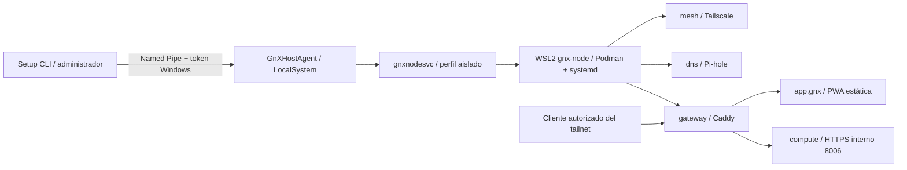

# GnX Node — arquitectura vigente

## Decisión

GnX Node instala un servicio Windows Rust, una identidad dedicada `gnxnodesvc`
y su distro WSL2 `gnx-node`. Podman/systemd ejecutan cuatro capacidades:

| Capacidad | Implementación | Contrato |
| --- | --- | --- |
| `mesh` | Tailscale | Red privada, `/dev/net/tun` |
| `dns` | Pi-hole | Split DNS privado `gnx` |
| `gateway` | Caddy | HTTPS para `app.gnx` y `compute.gnx` |
| `compute` | Imagen sellada Proxmox | KVM y HTTPS interno `8006` |

Desde v0.1.2, **Setup es una CLI Rust mínima**. v0.1.4 la publica como `gnx` en el PATH del host, permite rotar de forma segura la contraseña de Proxmox y conserva el flujo de actualización. No hay WebView2, assets locales
de Setup ni puente de credenciales en el navegador. `https://app.gnx` conserva
exclusivamente la vista cotidiana de estado y acceso a compute.

La sustitución afecta la presentación del alta, no el servicio, protocolo,
identidad dedicada, distro, imágenes ni límites de confianza.

## Instalación y uso

1. Burn eleva e instala el MSI. El MSI copia archivos y registra/inicia
   `GnXHostAgent`; no ejecuta provisioning Linux dentro de su transacción.
2. Al terminar, el usuario pulsa **Launch** para abrir `gnx --pause` elevado.
   Burn usa `ApprovedExeForElevation` y la ruta escrita por el MSI en HKLM.
   Las instalaciones silenciosas no abren prompts. Con MSI directo se ejecuta
   la consola instalada manualmente como administrador.
3. En un nodo nuevo, la CLI solicita contraseña Proxmox y confirmación con eco
   desactivado; envía `Provision`. Si alcanza `MESH_PENDING`, continúa en la misma
   ejecución solicitando la clave Tailscale `tskey-auth-*` y envía `JoinMesh`.
4. Un nodo `NODE_READY` no vuelve a pedir credenciales. Un nodo ya inscrito con
   fallo de verificación conserva sus credenciales; se reconcilia con `Retry`,
   no se interpreta el fallo como permiso para volver a inscribirlo.
5. El administrador completa Split DNS y confianza de la CA pública cuando sean
   necesarios. La interfaz cotidiana queda en `https://app.gnx`; Proxmox en
   `https://compute.gnx`.

```powershell
# En PowerShell elevado, después de instalar:
& "${env:ProgramFiles(x86)}\GnX Node\gnx.exe"
& "${env:ProgramFiles(x86)}\GnX Node\gnx.exe" status
& "${env:ProgramFiles(x86)}\GnX Node\gnx.exe" set password
& "${env:ProgramFiles(x86)}\GnX Node\gnx.exe" retry
```

El MSI agrega el directorio instalado al PATH de sistema. Una terminal nueva del usuario host puede invocar `gnx`; la identidad dedicada sigue sin login interactivo y no ejecuta la CLI.

Comandos: alta guiada sin argumentos o con `setup`; `status`, `set password`,
`join`, `retry`, `cancel`, `help`, `version`. `password` y `provision` se
mantienen como alias de `set password`. Esta operación permite definir o rotar
la contraseña de `root@pam` sin reemplazar la identidad mesh existente; el valor
se solicita dos veces con eco desactivado y nunca se acepta en argv. `--pause` mantiene visible el resultado en una
consola interactiva. No se aceptan credenciales por argumentos, variables de
entorno ni entrada redirigida. Un error del servicio produce salida no cero.

`status` es lectura. `retry` no lleva secretos: reconcilia el payload y las
reglas de ingreso y vuelve a verificar; **puede reiniciar compute/gateway**.
`cancel` registra un checkpoint seguro, no destruye recursos ni garantiza
interrumpir instantáneamente una llamada síncrona en curso.

## Límites de confianza



- Único control privilegiado: `\\.\pipe\GnX.Platform.Control`, DACL explícita
  `SYSTEM`/`Administrators`, clientes remotos rechazados y token elevado validado.
- Operaciones versionadas: `GetProgress`, `Provision`, `JoinMesh`, `Retry`,
  `Cancel`. No shell arbitrario, API HTTP localhost ni operación `Deprovision`.
- La CLI verifica el proceso servidor contra `gnx-host-agent.exe` instalado
  junto a ella. El agente limita frames, valida versión, replay y transición.
- La PWA no abre pipes, no controla Windows/WSL, no recoge credenciales y no
  almacena sesiones. Su Service Worker cachea solo assets, nunca `status.json`
  ni respuestas de compute.
- No se adoptan cuentas o distros ajenas. Se conserva el aislamiento del perfil
  y la credencial Windows protegida con DPAPI para el transporte existente.

## Secretos y estado

La contraseña Proxmox **la define la persona administradora** durante el alta;
no se descubre ni se genera una contraseña predeterminada desde la PWA.
La clave Tailscale también la proporciona esa persona.

Setup desactiva el eco antes de leer, restaura el modo de consola y borra los
buffers en memoria. Crea un bundle efímero en el directorio temporal del usuario,
aplica una DACL protegida antes de escribir valores y envía **solo la ruta**
por el pipe. El servicio consume/elimina el bundle y crea los archivos separados
`TS_AUTHKEY` y `PROXMOX_PASSWORD` para el contrato Linux. El cliente limpia el
bundle si la entrega falla; el servicio limpia su staging conocido al arrancar.

La clave de alta Tailscale se consume y elimina; una interrupción anterior a su
consumo puede requerir otra clave. La contraseña Proxmox sí se conserva en
`/var/lib/gnx-node/secrets/compute.env`, protegida con modo `0600`, para reinicios.
No se incluyen valores en Git, argv, URLs, logs, progreso ni estado público.
La CA privada queda protegida en `%ProgramData%\GnX\Node\state\ca`; solo se
presenta al usuario la ruta del certificado público.

La única fuente de estado Windows es `%ProgramData%\GnX\Node\state\`:
snapshot y journal sanitizados. El protocolo incluye estado/fase, secuencia,
identificador de operación, porcentaje, error, reinicio y acciones públicas.
Estados definidos: `NEW`, `WINDOWS_READY`, `REBOOT_REQUIRED`, `WSL_READY`,
`RUNTIME_READY`, `MESH_PENDING`, `NODE_READY`, `BLOCKED`, `FAILED`,
`RECOVERY_REQUIRED`. No se promete reanudación automática de pasos que necesiten
secretos después de reiniciar; se vuelve a ejecutar Setup para consultar y continuar.

`NODE_READY` exige verificación local; Split DNS y confianza de CA siguen siendo
acciones humanas separadas. Un fallo no se convierte en estado verde ni autoriza
borrar identidad, distro, datos o credenciales.

## Runtime y contratos externos

Rust orquesta archivos; no contiene scripts, Quadlets, firewall ni templates
Linux incrustados. Se conserva la arquitectura de archivos externos:

| Fuente | Uso |
| --- | --- |
| `payload/host/.wslconfig` | Perfil dedicado; virtualización anidada |
| `payload/host/gnx-node-rootfs.tar` y `.sha256` | Rootfs sellado; verificar antes de importar |
| `payload/node/install.run` | `check` / `install` idempotentes, secretos por ruta |
| `payload/node/verify.run` | Verificador canónico, JSONL sanitizado y exit code |
| `payload/node/services/` | Quadlets por capacidad e imágenes por digest |
| `payload/node/network/ingress.nft` | Ingreso limitado a loopback y tailnet |
| `payload/node/gateway/routes.conf` | PWA estática y proxy HTTPS a compute |
| `apps/web-app/` | Assets estáticos ensamblados dentro del payload Linux |

Tailscale requiere TUN, **no KVM**. Compute requiere `/dev/kvm` funcional y
virtualización habilitada en firmware/Windows; no se simula disponibilidad.
El gateway valida la CA de backend de Proxmox; nunca usa TLS inseguro.
El puerto interno `8006` no se publica directamente a LAN/tailnet. No se abre
DNS público ni puertos del router. Un apagado global de WSL/reinicio del host
requiere consentimiento; no se usa para validar una actualización por sorpresa.

## Actualización, retirada y organización

MSI/Burn mantienen UpgradeCodes estables y versiones crecientes. Cada versión nueva activa MajorUpgrade; ejecutar exactamente la misma versión es Repair, no se presenta como release nueva. Burn es la única entrada visible en Aplicaciones instaladas y oculta su MSI encadenado. La actualización conserva identidad, distro, datos, CA y credenciales. El MSI elimina los archivos
de Setup web de la versión anterior; no se mantienen dos mecanismos de alta.
`retry` aplica los assets nuevos al nodo existente sin introducir claves nuevas.
Una desinstalación real es destructiva: después de detener el servicio elimina la
distro administrada, identidad/perfil dedicados, estado, datos runtime, CA,
credenciales, entradas `hosts` GnX y el port-proxy loopback heredado. Las condiciones
`UPGRADINGPRODUCTCODE`/`WIX_UPGRADE_DETECTED` excluyen esta limpieza durante upgrades.
Una instalación genuinamente limpia también retira residuos de versiones antiguas
antes de iniciar el servicio, evitando publicar un Proxmox/LXC anterior.

El workspace es la raíz de este repositorio:

- `apps/host-agent/`: servicio y adaptadores Windows/Linux.
- `apps/setup/`: CLI y cliente del Named Pipe.
- `crates/control-protocol/`: mensajes y estados compartidos.
- `installer/`: `GnxNode.wixproj`, `Product.wxs`, `bundle/`, `scripts/`.
- `tests/`: contratos estáticos de instalación, runtime y seguridad; tests Rust
  junto al código.
- `target/`, `build/`: salidas generadas, fuera de Git.
- `releases/v*/`: instaladores, hashes y evidencia por versión; no se sobrescriben.

La asignación de agentes y reglas de coordinación viven en `.AGENTS/`, no en
planes históricos duplicados aquí. En esta migración solo el coordinador ejecuta
pruebas, builds, instaladores y verificación elevada.

## Validación

```text
cargo test --workspace --locked
node tests/test-static-contracts.mjs
powershell -ExecutionPolicy Bypass -File installer/scripts/build.ps1
powershell -ExecutionPolicy Bypass -File installer/scripts/verify.ps1
```

Los tests no sustituyen aceptación real: alta en Windows limpio, entrega y
limpieza de secretos, denegación de usuario no administrador, reinicio, KVM/TUN,
cuatro servicios, Split DNS/CA y HTTPS deben comprobarse en un host autorizado.
Las capturas de prompts no prueban una inscripción completada; una actualización
sobre un nodo existente tampoco equivale a instalación limpia. Los resultados y
límites efectivamente observados se registran en las notas de cada release.

Referencias: documentación Microsoft de WSL/`.wslconfig`, Proxmox VE
Administration Guide (HTTPS `8006`) y WiX 5 (`ApprovedExeForElevation`).
